# Etapa 1 - Análise Exploratória do Dataset (RodoFauna - IBRAM/DF)

*Gerado automaticamente por `etapa1_eda.py` em 05/11/2026 15:37. Arquivo: `rodofauna.xlsx`.*

## 1. Descrição do problema

Os dados vêm do Projeto RodoFauna (IBRAM/DF): percursos sistemáticos em rodovias do Distrito Federal (abr/2010 a mar/2015) registrando animais atropelados, com identificação taxonômica e coordenadas UTM. Cada linha é **uma ocorrência** (um animal encontrado atropelado). O objetivo do trabalho é prever a ocorrência, o tipo e a intensidade dos atropelamentos de fauna silvestre e identificar *hotspots*. Por isso a análise abaixo olha a base em dois níveis: o **registro individual** (para o problema multiclasse) e **unidades espaciais/temporais agregadas** (células de 500 m, para o problema binário de hotspot e para a regressão de contagens).

## 2. Base bruta: registros, atributos e tipos

- Registros na base bruta: **10.328**
- Atributos na base bruta: **20**

| atributo | tipo pandas | valores distintos | exemplo | natureza |
| --- | --- | --- | --- | --- |
| objectid | int64 | 10.328 | 1 | identificador |
| id | int64 | 5.164 | 1 | identificador |
| campanha | int64 | 482 | 1 | numérico discreto (controle amostral) |
| ano | int64 | 6 | 2010 | numérico discreto / temporal |
| periodo | int64 | 5 | 1 | numérico discreto (controle amostral) |
| mes | str | 12 | abril | categórico nominal |
| data_dt | str | 483 | 05/04/10 | data |
| dia_da_sem | str | 6 | seg | categórico nominal |
| silvestre_ | str | 2 | silvestre | categórico nominal |
| classe | str | 5 | birds | categórico nominal |
| ordem | str | 34 | apodiformes | categórico nominal |
| familia | str | 72 | apodidae | categórico nominal |
| especie_nm | str | 192 | streptoprocne_zonaris | categórico nominal |
| nome_popul | str | 176 | andorinhao_de_coleira | categórico nominal |
| uc | str | 4 | esecae | categórico nominal |
| x | int64 | 4.556 | 219467 | numérico contínuo (coordenada UTM) |
| y | int64 | 3.858 | 8273815 | numérico contínuo (coordenada UTM) |
| posicao | str | 11 | nao_identificado | categórico nominal |
| hora | str | 476 | nao_identificado | categórico nominal |
| sexo | str | 4 | nao_identificado | categórico nominal |

Distribuição de `silvestre_` na base bruta:

| silvestre_ | registros | % |
| --- | --- | --- |
| silvestre | 8.844 | 85,63 |
| domestico | 1.484 | 14,37 |

## 3. Filtragem: apenas fauna silvestre

Após `silvestre_ == 'silvestre'` restam **8.844 registros** (85,6% da base bruta). Todo o restante da análise usa só esses registros.
- Linhas duplicadas (todas as colunas exceto identificadores): **4.444**
- Linhas repetidas em (data, x, y, especie_nm) - possível mesmo animal registrado 2x: **4.457**

## 4. Valores ausentes e `nao_identificado`

| atributo | ausentes (NaN) | nao_identificado | % ausente | % nao_ident. | % total sem info | uso permitido como preditor? |
| --- | --- | --- | --- | --- | --- | --- |
| sexo | 0 | 8.506 | 0 | 96,18 | 96,18 | não (regra do enunciado) |
| posicao | 0 | 4.656 | 0 | 52,65 | 52,65 | não (regra do enunciado) |
| hora | 0 | 3.326 | 0 | 37,61 | 37,61 | não (regra do enunciado) |
| especie_nm | 0 | 2002 | 0 | 22,64 | 22,64 | alvo |
| familia | 0 | 1.684 | 0 | 19,04 | 19,04 | não (regra do enunciado) |
| ordem | 0 | 342 | 0 | 3,87 | 3,87 | não (regra do enunciado) |
| nome_popul | 0 | 156 | 0 | 1,76 | 1,76 | não (regra do enunciado) |
| uc | 0 | 4 | 0 | 0,05 | 0,05 | sim |
| classe | 0 | 2 | 0 | 0,02 | 0,02 | alvo |
| campanha | 0 | 0 | 0 | 0 | 0 | não (regra do enunciado) |
| id | 0 | 0 | 0 | 0 | 0 | não (regra do enunciado) |
| objectid | 0 | 0 | 0 | 0 | 0 | não (regra do enunciado) |
| ano | 0 | 0 | 0 | 0 | 0 | sim |
| silvestre_ | 0 | 0 | 0 | 0 | 0 | não (regra do enunciado) |
| data_dt | 0 | 0 | 0 | 0 | 0 | sim |
| dia_da_sem | 0 | 0 | 0 | 0 | 0 | sim |
| periodo | 0 | 0 | 0 | 0 | 0 | não (regra do enunciado) |
| mes | 0 | 0 | 0 | 0 | 0 | não (regra do enunciado) |
| x | 0 | 0 | 0 | 0 | 0 | sim |
| y | 0 | 0 | 0 | 0 | 0 | sim |

- Datas que não puderam ser convertidas em `data_dt`: **0**

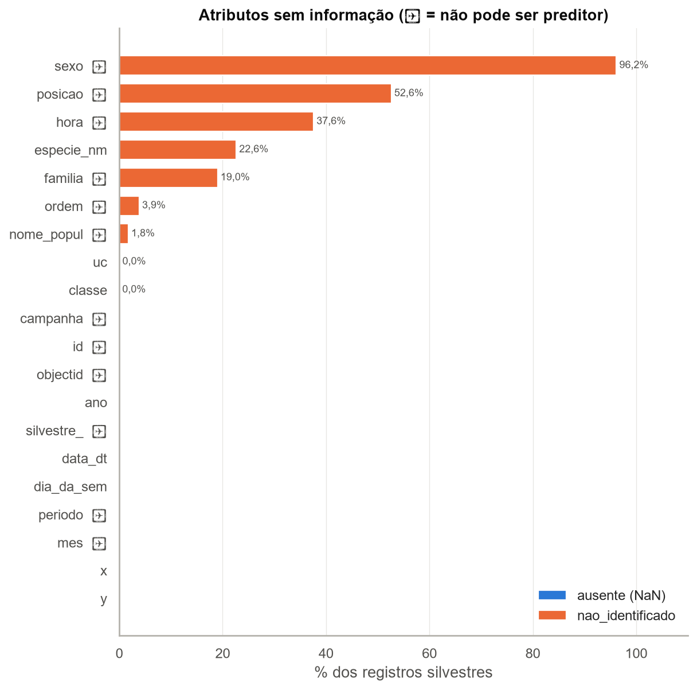
*Figura 1 - Percentual de valores ausentes e nao_identificado por atributo.*

## 5. Atributos derivados (engenharia de atributos inicial)

A partir de `data_dt` foram derivados: `mes_num`, `dia_do_ano`, `dia_semana_num` (0 = segunda), `fim_de_semana` (sáb/dom = 1), `estacao` (verão = dez-fev, outono = mar-mai, inverno = jun-ago, primavera = set-nov) e `periodo_climatico` (chuvoso = out-abr, seco = mai-set, regime típico do Cerrado no DF). A partir de `x`,`y` foi criada a célula espacial de 500 m (`cel_x`, `cel_y`), usada como aproximação de segmento rodoviário.

## 6. Estatísticas descritivas das variáveis numéricas

| variável | count | mean | std | min | 25% | 50% | 75% | max | assimetria | curtose |
| --- | --- | --- | --- | --- | --- | --- | --- | --- | --- | --- |
| x | 8.844 | 199.824,18 | 18.855,51 | 168.694 | 183.469 | 197.849 | 217.628 | 228.478 | -0,19 | -1,42 |
| y | 8.844 | 8.261.912,75 | 17.370,31 | 8.230.610 | 8.241.138 | 8.271.545,50 | 8.274.591 | 8.282.622 | -0,73 | -1,08 |
| ano | 8.844 | 2012,29 | 1,39 | 2010 | 2011 | 2012 | 2013 | 2015 | 0,24 | -0,90 |
| mes_num | 8.844 | 5,92 | 4,01 | 1 | 2 | 5 | 10 | 12 | 0,25 | -1,55 |
| dia_do_ano | 8.844 | 164,90 | 122,43 | 2 | 52 | 125 | 297 | 364 | 0,26 | -1,54 |
| dia_semana_num | 8.844 | 1,68 | 1,51 | 0 | 0 | 2 | 3 | 4 | -0,01 | -1,73 |
| fim_de_semana | 8.844 | 0 | 0 | 0 | 0 | 0 | 0 | 0 | - | - |

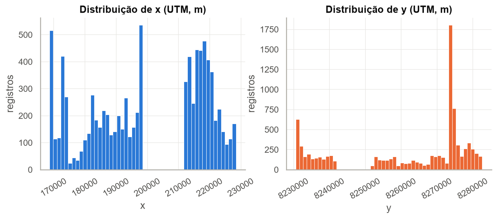
*Figura 2 - Histogramas das coordenadas UTM x e y.*

## 7. Outliers e consistência

- Coordenadas ausentes ou zero: **0**
- Fora da envoltória plausível do DF em UTM 23S (x 135.000-265.000; y 8.210.000-8.300.000): **0**
- Outliers pelo critério de Tukey (1,5·IQR) em x ou y: **0** (0,0%). Em dados espaciais, ponto fora do IQR não é necessariamente erro: pode ser apenas uma rodovia mais afastada do centro da malha amostrada. Só os pontos fora do DF são candidatos a erro de digitação/projeção.
- Período coberto por `data_dt`: **05/04/2010 a 30/03/2015**; registros fora de abr/2010-mar/2015: **0**

Consistência entre campos temporais originais e `data_dt` (se ~100%, o campo é **redundante**):

| atributo original | derivado de data_dt | % concordância | divergências |
| --- | --- | --- | --- |
| ano | data_dt.year | 100 | 0 |
| mes | data_dt.month | 100 | 0 |
| dia_da_sem | data_dt.dayofweek | 99,41 | 52 |

## 8. Variáveis-alvo e distribuição das classes

### 8.1 Experimento multiclasse - alvo `classe` (grupo taxonômico)

| classe | registros | % |
| --- | --- | --- |
| birds (Aves) | 6.018 | 68,05 |
| reptiles (Répteis) | 1.380 | 15,60 |
| mammals (Mamíferos) | 896 | 10,13 |
| amphibians (Anfíbios) | 548 | 6,20 |
| nao_identificado | 2 | 0,02 |

- Razão de desbalanceamento (maior/menor classe): **11,0 : 1** (Aves × Anfíbios)
- Acurácia de um classificador trivial que sempre prevê 'Aves': **68,1%** - é a linha de base que qualquer modelo precisa superar; por isso a métrica principal deve ser F1 macro, não acurácia.

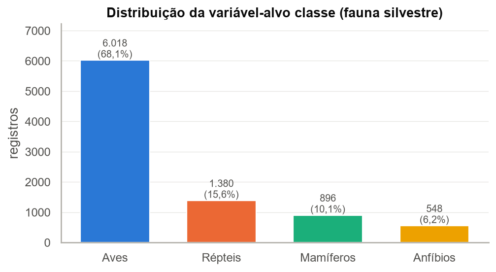
*Figura 3 - Distribuição das classes taxonômicas (alvo multiclasse).*

### 8.2 Alvo alternativo `especie_nm`

- Espécies distintas identificadas: **179**; registros sem espécie identificada: **2.002** (22,6%)

| k | espécies com ≥ k registros | registros cobertos | % dos registros c/ espécie |
| --- | --- | --- | --- |
| 10 | 82 | 6.506 | 95,09 |
| 30 | 41 | 5.756 | 84,13 |
| 50 | 23 | 5.110 | 74,69 |
| 100 | 14 | 4.514 | 65,97 |

- Espécies com apenas 1 registro: **0** (0,0% das espécies)

Top 15 espécies:

| especie_nm | registros | classe |
| --- | --- | --- |
| volatinia_jacarina | 2.442 | birds |
| rhinella_sp | 380 | amphibians |
| athene_cunicularia | 228 | birds |
| amphisbaena_alba | 206 | reptiles |
| crotalus_durissus | 188 | reptiles |
| cerdocyon_thous | 158 | mammals |
| crotophaga_ani | 126 | birds |
| didelphis_albiventris | 122 | mammals |
| tyrannus_savana | 122 | birds |
| boa_constrictor | 116 | reptiles |
| tyto_furcata | 112 | birds |
| guira_guira | 110 | birds |
| oxyrhopus_sp | 104 | reptiles |
| philodryas_sp | 100 | reptiles |
| oxyrhopus_guibei | 86 | reptiles |

- Espécies associadas a mais de uma `classe`: **0** - cada espécie pertence a uma única classe, ou seja, `especie_nm` (assim como `ordem`/`familia`) **determina** `classe`; usar uma como entrada para prever a outra seria vazamento de informação.

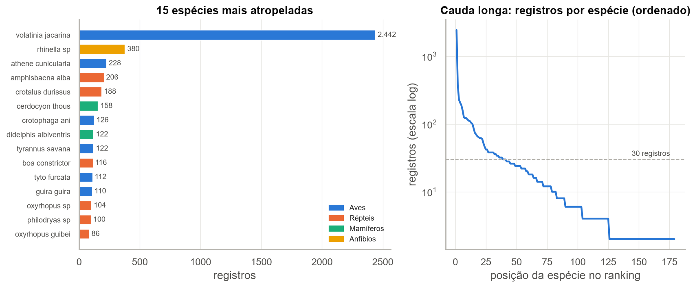
*Figura 4 - Espécies mais frequentes e distribuição de cauda longa.*

### 8.3 Experimento binário - hotspot por célula de 500 m

A base só contém **ocorrências**, então não existe classe negativa pronta. Como primeiro passo, os registros foram agregados em células de 500 m × 500 m (aproximação de segmento rodoviário de ~500 m). Há **293 células com pelo menos 1 atropelamento**.

| registros por célula ocupada (500 m) | valor |
| --- | --- |
| média | 30,18 |
| mediana | 20 |
| desvio-padrão | 30,28 |
| máximo | 192 |
| P75 | 44 |
| P90 | 67,60 |
| P95 | 90 |
| % células com 1 só registro | 0 |

Candidatos de limiar para a classe 1 (alto risco), entre as células **ocupadas**:

| critério de alto risco | células positivas | % das células ocupadas | atropelamentos nessas células | % dos atropelamentos |
| --- | --- | --- | --- | --- |
| ≥ 2 registros | 293 | 100 | 8.844 | 100 |
| ≥ P75 (44) | 75 | 25,60 | 5.396 | 61,01 |
| ≥ P90 (68) | 30 | 10,24 | 2.938 | 33,22 |

**Atenção para a Etapa 2:** a classe 0 não pode ser "qualquer lugar sem ponto". O caminho defensável é obter a geometria das rodovias percorridas (ex.: OpenStreetMap ou malha do DER-DF), dividi-las em segmentos de 500 m e contar os atropelamentos por segmento; segmentos monitorados com 0 ou poucos registros viram a classe 0. Sem a malha, uma alternativa é classificar só entre células ocupadas (baixo × alto risco pelo limiar acima), deixando explícito que o modelo distingue intensidade, não presença/ausência.
Sensibilidade ao tamanho da célula (ajuda a justificar a unidade espacial):

| célula (m) | células ocupadas | média reg./célula | mediana | % células c/ 1 registro | máximo |
| --- | --- | --- | --- | --- | --- |
| 250 | 583 | 15,17 | 10 | 0 | 118 |
| 500 | 293 | 30,18 | 20 | 0 | 192 |
| 1.000 | 154 | 57,43 | 42 | 0 | 324 |
| 2000 | 76 | 116,37 | 94 | 0 | 626 |

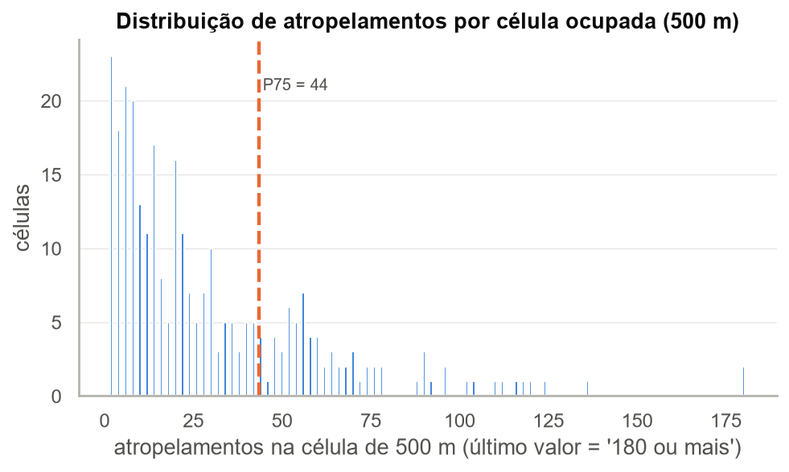
*Figura 5 - Quantas células de 500 m têm 1, 2, 3... atropelamentos.*

### 8.4 Experimento de regressão - atropelamentos por célula de 500 m por mês

Para a regressão os registros precisam ser agregados. Unidade proposta: **célula de 500 m × mês**, completando com 0 os meses sem registro (assumindo que o trecho foi percorrido todo mês; ver esforço amostral na seção 10). Painel: 293 células × 60 meses = **17.580 observações**.

| contagem célula×mês | valor |
| --- | --- |
| média | 0,50 |
| variância | 1,80 |
| variância / média (dispersão) | 3,57 |
| % de zeros | 82,51 |
| máximo | 26 |

- Variância/média > 1 indica **sobredispersão** e a grande proporção de zeros indica **inflação de zeros**: é esperado que MAE/RMSE fiquem baixos só por prever ~0, então convém comparar com um baseline (média histórica da célula) e considerar agregação mais grossa (célula × trimestre/estação, ou `uc` × mês) se o sinal for fraco.

Comparação de unidades de agregação candidatas:

| unidade | observações | média | var/média | % zeros |
| --- | --- | --- | --- | --- |
| célula 500 m × mês | 17.580 | 0,50 | 3,57 | 82,51 |
| uc × mês | 240 | 36,85 | 40,78 | 24,17 |
| célula 500 m × trimestre | 5.860 | 1,51 | 5,45 | 62,70 |

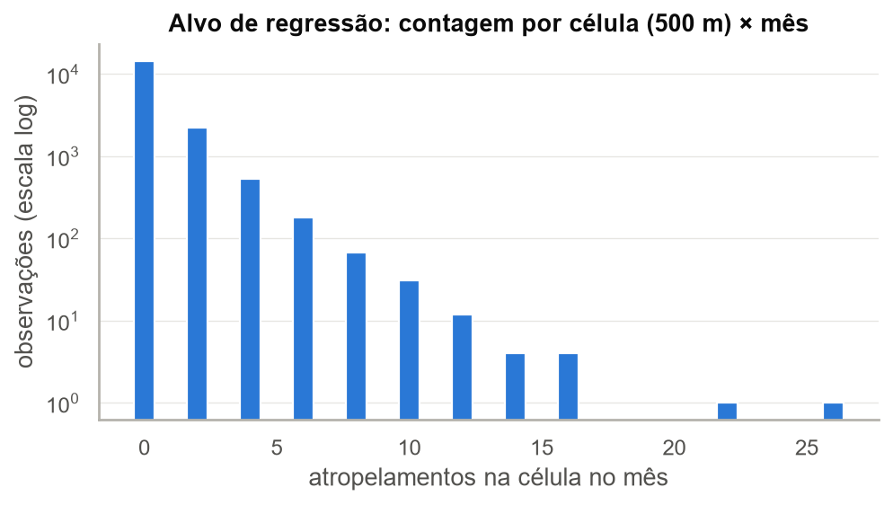
*Figura 6 - Distribuição do alvo de regressão (observe a massa de zeros).*

## 9. Distribuição espacial dos atropelamentos

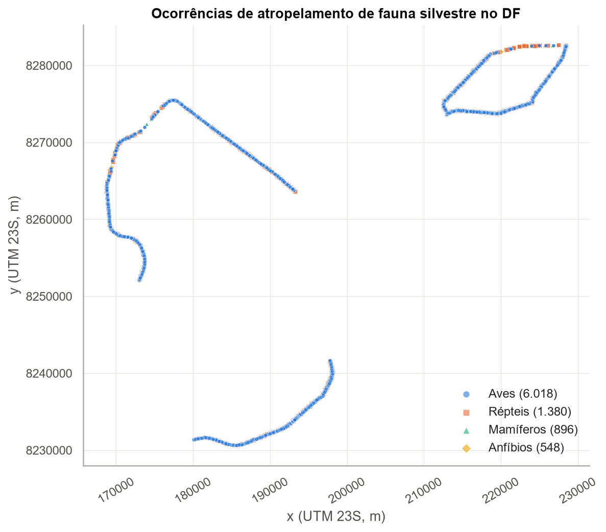
*Figura 7 - Mapa (UTM) das ocorrências por classe. Os pontos desenham a malha rodoviária percorrida.*

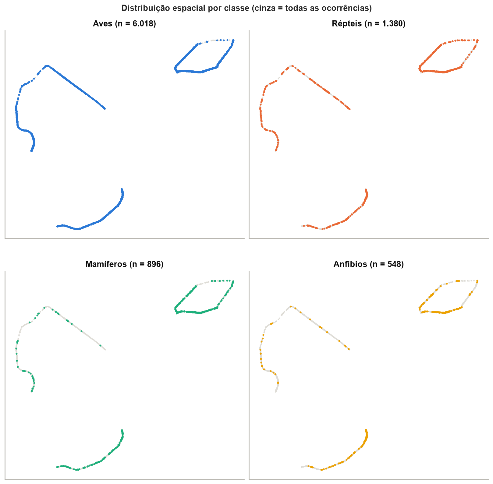
*Figura 8 - Mapas por classe taxonômica.*

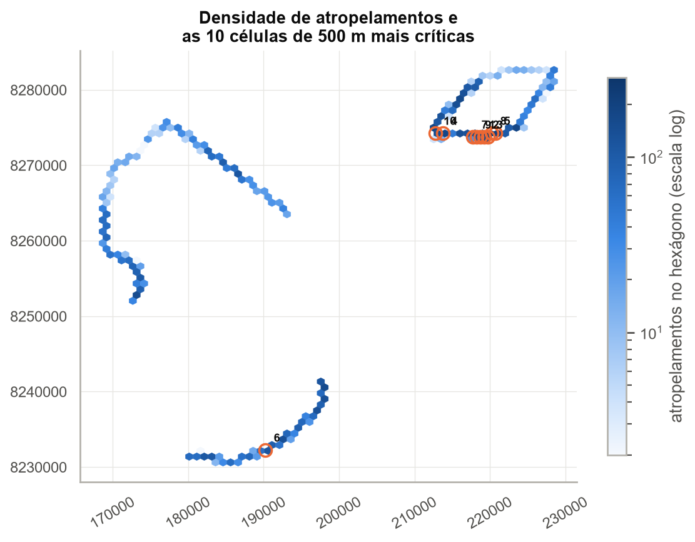
*Figura 9 - Densidade espacial (hexbin) e as 10 células com mais registros (círculos numerados).*

10 células de 500 m com mais atropelamentos (centro da célula em UTM):

| rank | registros | x_centro | y_centro | uc predominante |
| --- | --- | --- | --- | --- |
| 1 | 192 | 218.750 | 8.273.750 | esecae |
| 2 | 188 | 219.250 | 8.273.750 | esecae |
| 3 | 136 | 219.750 | 8.273.750 | esecae |
| 4 | 124 | 213.750 | 8.274.250 | esecae |
| 5 | 120 | 220.750 | 8.274.250 | esecae |
| 6 | 118 | 190.250 | 8.232.250 | jbb_fal_ibge |
| 7 | 116 | 217.750 | 8.273.750 | esecae |
| 8 | 112 | 220.250 | 8.274.250 | esecae |
| 9 | 110 | 218.250 | 8.273.750 | esecae |
| 10 | 104 | 212.750 | 8.274.250 | esecae |

- As 10 células mais críticas concentram **14,9%** dos atropelamentos com coordenada válida, ocupando 3,4% das células ocupadas.

### 9.1 Unidade de conservação (`uc`)

| uc | registros | % |
| --- | --- | --- |
| esecae | 4.048 | 45,77 |
| pnb | 2.514 | 28,43 |
| jbb_fal_ibge | 2.278 | 25,76 |
| nao_identificado | 4 | 0,05 |

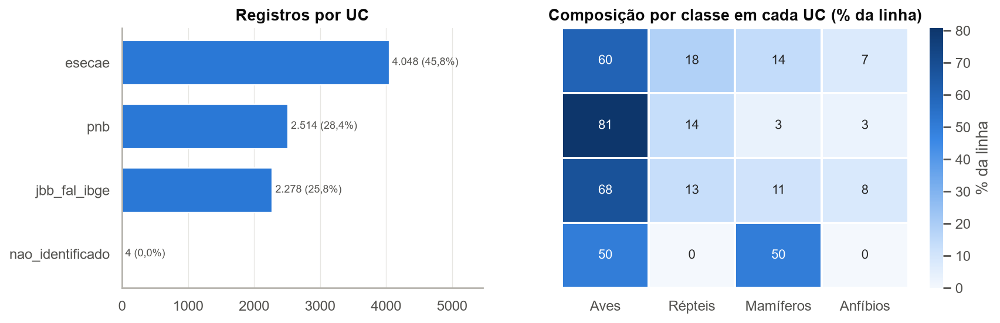
*Figura 10 - Registros por unidade de conservação e composição taxonômica.*

- Associação `uc` × `classe`: χ² = 390,5, p = 1.48e-78, V de Cramér = **0,120**

### 9.2 Proximidade entre ocorrências (implicação para a divisão treino/teste)

- Distância até a ocorrência mais próxima: mediana **0 m**, P25 = 0 m, P75 = 0 m
- Ocorrências com outra a menos de 100 m: **100,0%**; a menos de 500 m: **100,0%**; coordenada idêntica a outra: **100,0%**
- Proporção de ocorrências cujo vizinho mais próximo é da **mesma classe**: **96,1%** (esperado ao acaso, dadas as proporções: 50,2%).

Com split aleatório, quase todo ponto de teste terá um vizinho a poucas dezenas de metros no treino. Se o vizinho tende a ter a mesma classe (valor acima do esperado ao acaso), um modelo baseado em x,y pode "decorar" o local e a métrica de teste fica otimista. Isso motiva o experimento com **split espacial** (ex.: blocos de vários km ou por UC/rodovia) e/ou **temporal** (ex.: treinar 2010-2013 e testar 2014-2015) na Etapa 2.

*Figura 11 - Distância ao vizinho mais próximo: base do argumento contra o split aleatório.*

## 10. Distribuição temporal dos atropelamentos

| ano | registros | meses_com_registro | registros por mês | campanhas | registros por campanha |
| --- | --- | --- | --- | --- | --- |
| 2010 | 690 | 9 | 76,67 | 72 | 9,58 |
| 2011 | 2.430 | 12 | 202,50 | 96 | 25,31 |
| 2012 | 1.890 | 12 | 157,50 | 96 | 19,69 |
| 2013 | 1.856 | 12 | 154,67 | 100 | 18,56 |
| 2014 | 1.380 | 12 | 115 | 94 | 14,68 |
| 2015 | 598 | 3 | 199,33 | 24 | 24,92 |

2010 (a partir de abril) e 2015 (até março) são anos **incompletos**; comparar anos pela contagem bruta é enganoso - usar registros por mês ou por campanha.

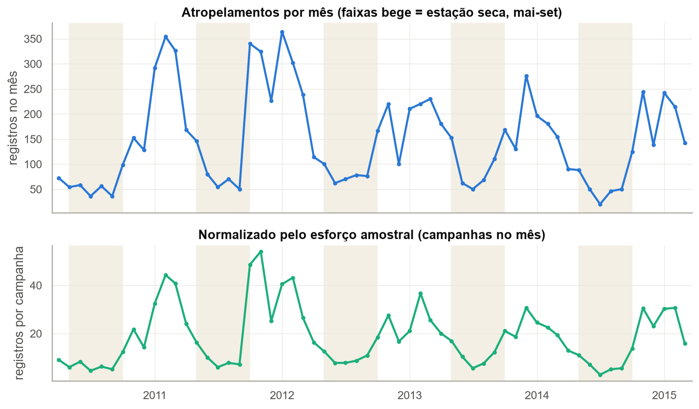
*Figura 12 - Série mensal bruta e normalizada pelo esforço amostral.*

- Meses com 0 campanhas no período: **0**; campanhas por mês: mínimo 6, mediana 8, máximo 10. Se o esforço varia, a contagem mensal mistura risco com intensidade de amostragem.

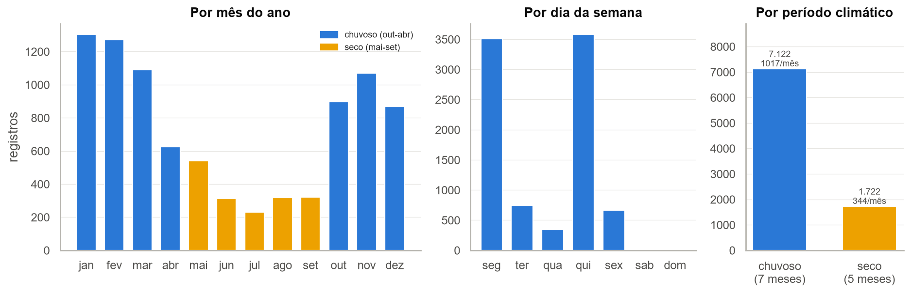
*Figura 13 - Atropelamentos por mês do ano, dia da semana e período climático.*

Registros e campanhas por dia da semana (se não há campanhas no fim de semana, `fim_de_semana` reflete a **agenda da equipe**, não o risco):

| dia | registros | campanhas | registros por campanha |
| --- | --- | --- | --- |
| seg | 3.508 | 192 | 18,27 |
| ter | 744 | 39 | 19,08 |
| qua | 344 | 19 | 18,11 |
| qui | 3.582 | 191 | 18,75 |
| sex | 666 | 42 | 15,86 |
| sab | 0 | 0 | - |
| dom | 0 | 0 | - |

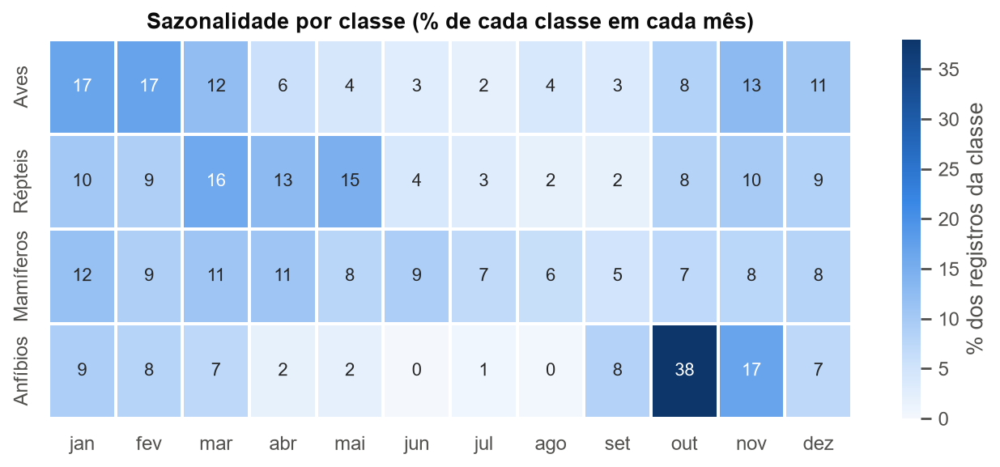
*Figura 14 - Sazonalidade por classe (cada linha soma 100%).*

- `classe` × `periodo_climatico`: χ² = 221,9, p = 7.27e-47, V de Cramér = **0,157**
- `classe` × `ano`: χ² = 138,3, p = 1.06e-19, V de Cramér = **0,058**

## 11. Correlação e redundância entre atributos

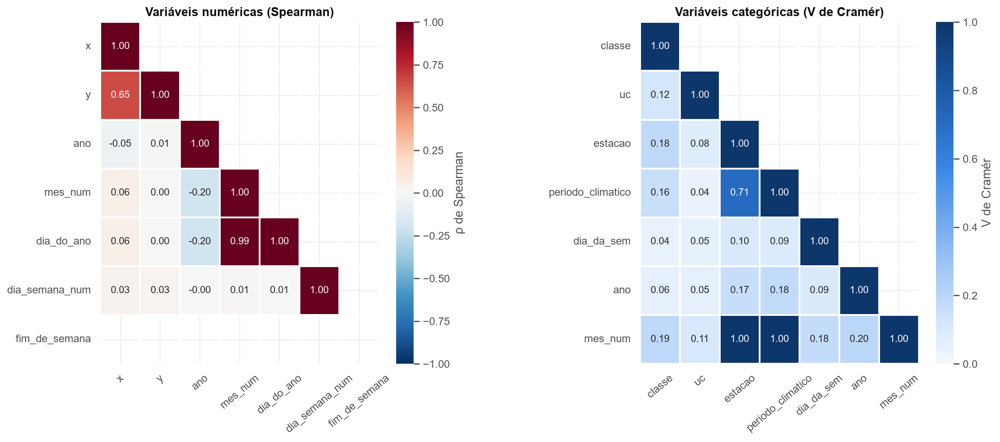
*Figura 15 - Correlação entre numéricas (Spearman) e associação entre categóricas (V de Cramér).*

Pares com associação forte (|valor| ≥ 0,7):

| par | medida | valor |
| --- | --- | --- |
| mes_num × dia_do_ano | Spearman | 0,99 |
| estacao × periodo_climatico | Cramér | 0,71 |
| estacao × mes_num | Cramér | 1,00 |
| periodo_climatico × mes_num | Cramér | 1,00 |

Redundâncias **por construção** (independentes do coeficiente):
- `ano`, `mes`, `dia_da_sem` são deriváveis de `data_dt` (ver tabela de consistência na seção 7).
- `estacao` e `periodo_climatico` são funções de `mes_num`; `dia_do_ano` ≈ `mes_num` refinado. Para a MLP, recomenda-se codificar mês/dia do ano de forma **cíclica** (seno e cosseno), evitando a falsa distância entre dezembro (12) e janeiro (1).
- `ordem` → `familia` → `especie_nm` → `classe` formam uma hierarquia: qualquer um deles revela a classe (vazamento).
- `uc` é praticamente função da posição: em média **99,1%** dos registros de uma célula de 500 m têm a mesma `uc` (93,5% das células são 100% de uma única UC). Com `x`,`y` no modelo, `uc` acrescenta pouca informação nova - mas é mais interpretável.

## 12. Resumo dos problemas encontrados e encaminhamento para a Etapa 2

- 4.444 registros duplicados exatos (remover no pré-processamento).
- Atributos com ≥50% sem informação: `sexo` (96%), `posicao` (53%) - todos já excluídos como preditores pelo enunciado, o que se justifica também pela falta de informação.
- Alvo `classe` tem 2 registros sem identificação (0,0%) - devem ser removidos do experimento que usa esse alvo.
- Alvo `especie_nm` tem 2002 registros sem identificação (22,6%) - devem ser removidos do experimento que usa esse alvo.
- `uc` sem informação em 0,0% dos registros - tratar como categoria própria ('fora_de_uc'/'desconhecida') ou imputar pela localização.
- `dia_da_sem` diverge de `data_dt` em 52 registros - conferir qual campo está certo.
- `classe` desbalanceada (11,0:1). Usar estratificação no split, F1 macro, `class_weight='balanced'` e/ou reamostragem.
- Alvo de regressão célula×mês tem 83% de zeros - considerar agregação temporal maior (trimestre/estação) ou espacial maior (1 km).
- `uc` tem 1 categoria(s) com <30 registros (nao_identificado) - agrupar em 'outras' antes do One-Hot Encoding.
- Autocorrelação espacial do alvo: 96% dos vizinhos mais próximos têm a mesma classe (acaso: 50%). Split aleatório tende a superestimar o desempenho.
- Não há campanhas aos sábados/domingos: `dia_da_sem`/`fim_de_semana` mede a rotina de amostragem, não o tráfego - pouco útil como preditor.
- Atributos redundantes/fortemente associados: mes_num × dia_do_ano (0,99); estacao × periodo_climatico (0,71); estacao × mes_num (1,00); periodo_climatico × mes_num (1,00). Manter apenas um de cada par (ou usar representação cíclica seno/cosseno para mês/dia do ano).

## 13. Variáveis-alvo propostas por experimento

| experimento | variável-alvo | unidade de análise | atributos de entrada candidatos |
| --- | --- | --- | --- |
| Classificação multiclasse | classe (aves, mamíferos, répteis, anfíbios) | registro individual | x, y (ou célula), uc, ano, mês (cíclico), dia do ano, período climático, estação |
| Classificação binária | hotspot = 1 se nº de atropelamentos no segmento/célula de 500 m ≥ limiar | célula/segmento de 500 m | posição do centro, uc, densidade na vizinhança (excluindo a própria célula), dados externos |
| Regressão | nº de atropelamentos | célula de 500 m × mês (ou × trimestre) | posição, uc, mês (cíclico), período climático, esforço (campanhas), histórico defasado |
