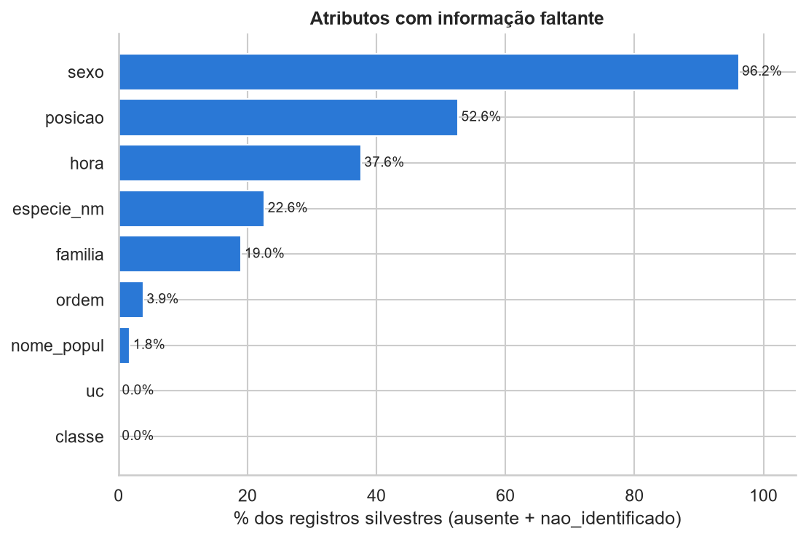
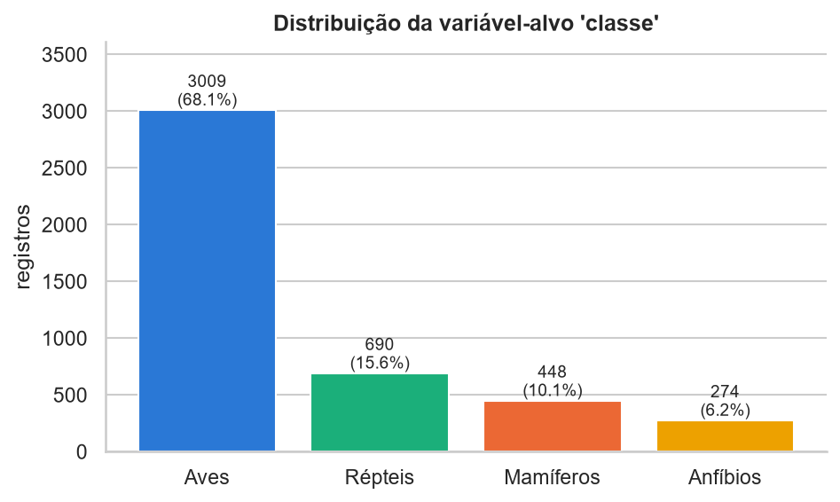
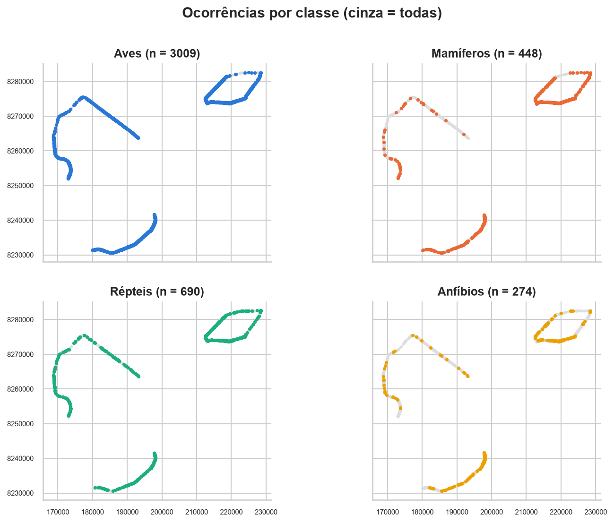
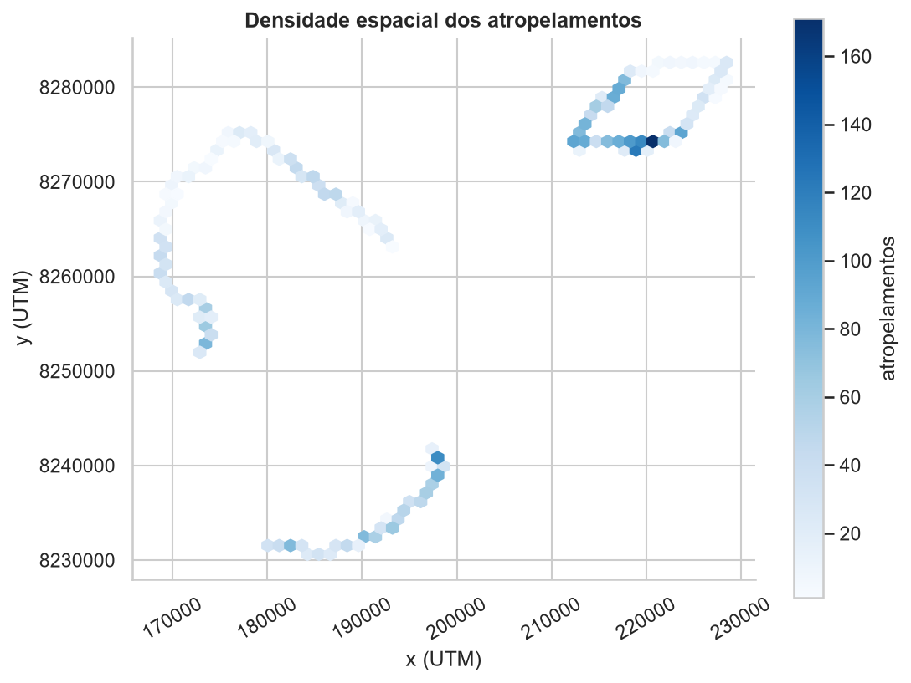
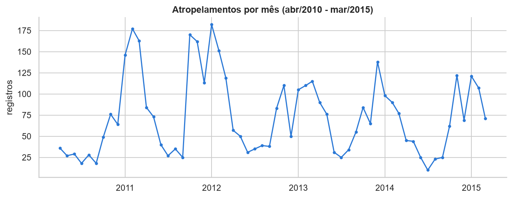
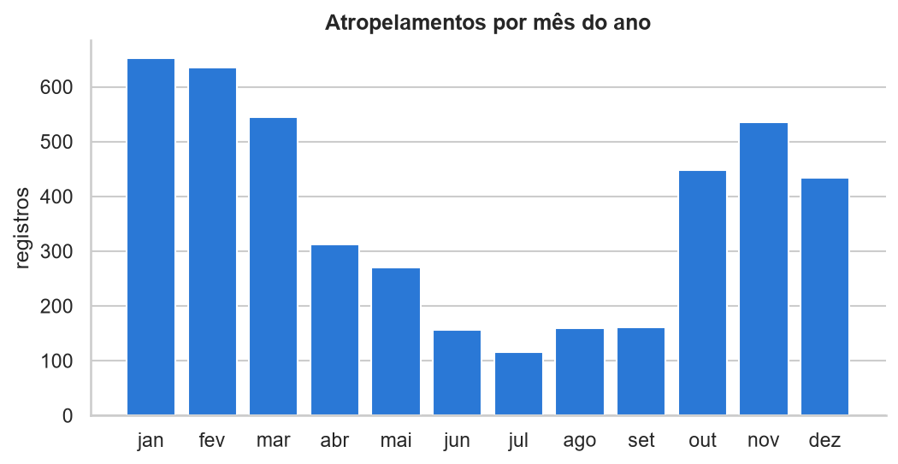
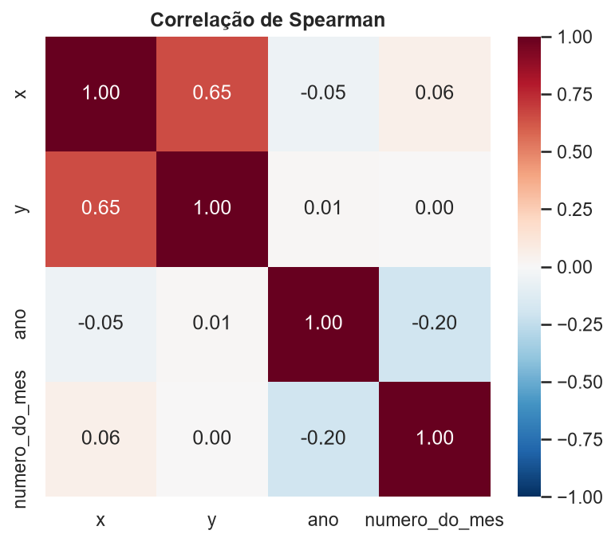

# Etapa 1 - Análise Exploratória do Dataset (RodoFauna / IBRAM-DF)

## 1. Descrição do problema

Base do Projeto RodoFauna (IBRAM/DF): animais encontrados atropelados em percursos sistemáticos nas rodovias do DF entre abr/2010 e mar/2015.  
Cada linha é uma ocorrência (um animal), com data, classificação taxonômica, unidade de conservação (uc) e coordenadas UTM (x, y).  
Objetivo: prever o tipo e a intensidade/ocorrência de atropelamentos de fauna SILVESTRE e identificar trechos críticos (hotspots).  

## 2. Registros, atributos e tipos

Arquivo: data\rodofauna.xlsx  
Quantidade de registros: 10328  
Quantidade de atributos: 20  

Tipos dos atributos:  

|  | tipo | valores_distintos |
|---|---|---|
| objectid | int64 | 10328 |
| id | int64 | 5164 |
| campanha | int64 | 482 |
| ano | int64 | 6 |
| periodo | int64 | 5 |
| mes | string | 12 |
| data_dt | string | 483 |
| dia_da_sem | string | 6 |
| silvestre_ | string | 2 |
| classe | string | 5 |
| ordem | string | 34 |
| familia | string | 72 |
| especie_nm | string | 192 |
| nome_popul | string | 176 |
| uc | string | 4 |
| x | int64 | 4556 |
| y | int64 | 3858 |
| posicao | string | 11 |
| hora | string | 476 |
| sexo | string | 4 |

Registros silvestres x domésticos:  

| silvestre_ | registros |
|---|---|
| silvestre | 8844 |
| domestico | 1484 |

Registros de fauna silvestre (usados no restante da análise): 8844  
Registros duplicados (todas as colunas iguais, exceto objectid): 4422  
Sem as duplicatas, a análise segue com 4422 registros.  

## 3. Valores ausentes e 'nao_identificado'

|  | ausentes | nao_identificado | percentual_sem_informacao |
|---|---|---|---|
| sexo | 0 | 4253 | 96.18 |
| posicao | 0 | 2328 | 52.65 |
| hora | 0 | 1663 | 37.61 |
| especie_nm | 0 | 1001 | 22.64 |
| familia | 0 | 842 | 19.04 |
| ordem | 0 | 171 | 3.87 |
| nome_popul | 0 | 78 | 1.76 |
| uc | 0 | 2 | 0.05 |
| classe | 0 | 1 | 0.02 |

*Figura 1 - Percentual de valores ausentes/nao_identificado por atributo*

## 4. Variável-alvo de cada experimento e distribuição das classes

Variável-alvo de cada experimento:  
- Classificação multiclasse: 'classe' (aves, mamíferos, répteis, anfíbios)
- Classificação binária: alto/baixo risco de atropelamento por segmento da rodovia
- Regressão: número de atropelamentos por segmento da rodovia (e por período)
Os alvos binário e de regressão não existem prontos na base: são construídos agregando os registros por segmento, o que é feito nas próximas etapas.  

Distribuição da variável 'classe':  

| classe | registros | percentual |
|---|---|---|
| birds | 3009 | 68.05 |
| reptiles | 690 | 15.6 |
| mammals | 448 | 10.13 |
| amphibians | 274 | 6.2 |
| nao_identificado | 1 | 0.02 |

Razão entre a maior e a menor classe: 11.0 : 1  

*Figura 2 - Distribuição da variável-alvo classe*

Distribuição da variável 'especie_nm' (possível alvo alternativo):  
- espécies distintas: 179
- espécies com pelo menos 10 registros: 59
- espécies com pelo menos 30 registros: 22
- espécies com pelo menos 100 registros: 4
- espécies com menos de 10 registros: 120

## 5. Estatísticas descritivas das variáveis numéricas

|  | quantidade | média | desvio_padrão | mínimo | 1º_quartil | mediana | 3º_quartil | máximo |
|---|---|---|---|---|---|---|---|---|
| x | 4422 | 199824.18 | 18856.58 | 168694 | 183471.25 | 197849 | 217625.25 | 228478 |
| y | 4422 | 8261912.75 | 17371.29 | 8230610 | 8241139 | 8271545.5 | 8274590.75 | 8282622 |
| ano | 4422 | 2012.29 | 1.39 | 2010 | 2011 | 2012 | 2013 | 2015 |

Outliers em x e y (critério de Tukey: fora de [Q1 - 1,5*IQR, Q3 + 1,5*IQR]):  
- x: 0 outliers
- y: 0 outliers

*Figura 3 - Boxplots das coordenadas x e y*

## 6. Distribuição espacial dos atropelamentos

*Figura 4 - Distribuição espacial por classe*

*Figura 5 - Densidade espacial dos atropelamentos*

## 7. Distribuição temporal dos atropelamentos

Período: 05/04/2010 a 30/03/2015  
(2010 começa em abril e 2015 termina em março: anos incompletos)  

Registros por ano:  

| ano | registros |
|---|---|
| 2010 | 345 |
| 2011 | 1215 |
| 2012 | 945 |
| 2013 | 928 |
| 2014 | 690 |
| 2015 | 299 |

Registros por mês do ano:  

| mês | registros |
|---|---|
| jan | 652 |
| fev | 635 |
| mar | 545 |
| abr | 312 |
| mai | 270 |
| jun | 156 |
| jul | 115 |
| ago | 159 |
| set | 161 |
| out | 448 |
| nov | 535 |
| dez | 434 |

*Figura 6 - Série mensal de atropelamentos*

*Figura 7 - Atropelamentos por mês do ano*

## 8. Atributos redundantes e correlação entre atributos

'ano', 'mes' e 'dia_da_sem' podem ser obtidos a partir de 'data_dt'.  
- 'ano' igual ao ano de 'data_dt' em 100.0% dos registros

Correlação de Spearman entre as variáveis numéricas:  

|  | x | y | ano | numero_do_mes |
|---|---|---|---|---|
| x | 1 | 0.65 | -0.05 | 0.06 |
| y | 0.65 | 1 | 0.01 | 0 |
| ano | -0.05 | 0.01 | 1 | -0.2 |
| numero_do_mes | 0.06 | 0 | -0.2 | 1 |

*Figura 8 - Correlação de Spearman entre as variáveis numéricas*

Nenhum par de variáveis numéricas com correlação elevada (>= 0,7).  

## 9. Resumo dos possíveis problemas encontrados

1. Registros duplicados: 4422 (50.0% dos registros silvestres).  
2. 'sexo' sem informação em 96% dos registros.  
3. 'posicao' sem informação em 53% dos registros.  
4. 'hora' sem informação em 38% dos registros.  
5. Classes desbalanceadas: 'birds' tem 68% dos registros e a maior classe é 11.0 vezes a menor.  
6. Classes com poucos exemplos: 120 das 179 espécies têm menos de 10 registros.  
7. Atributos redundantes: 'ano', 'mes' e 'dia_da_sem' repetem a informação de 'data_dt'.  