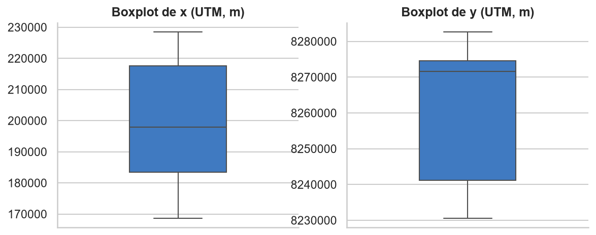
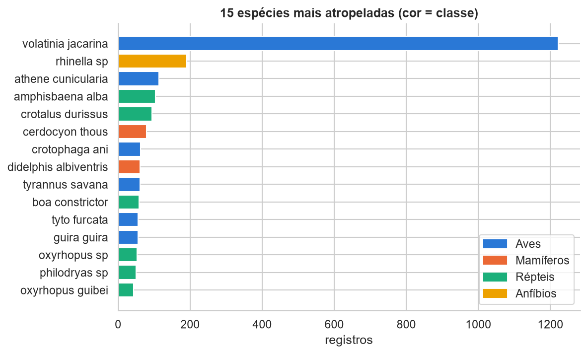
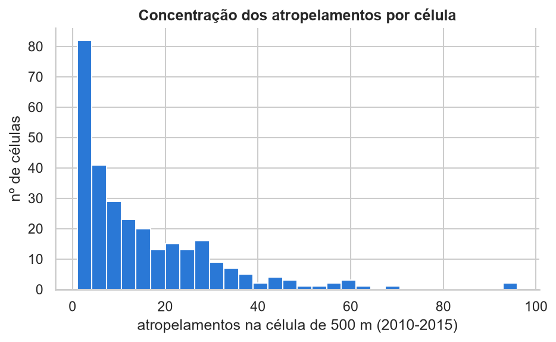
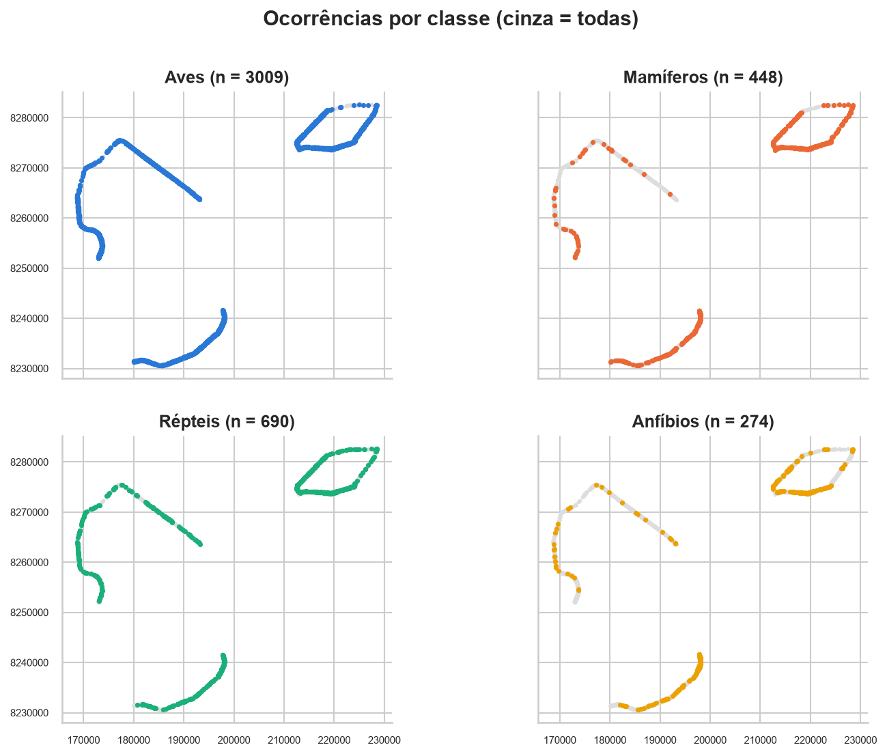
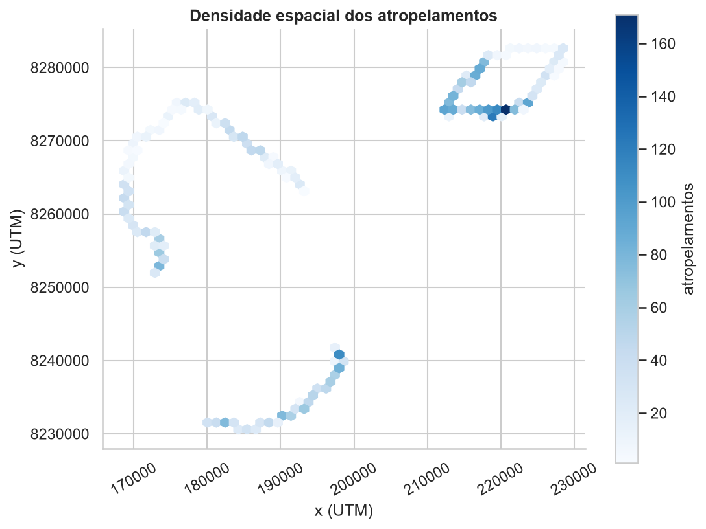
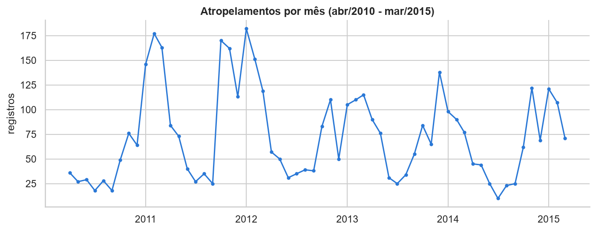
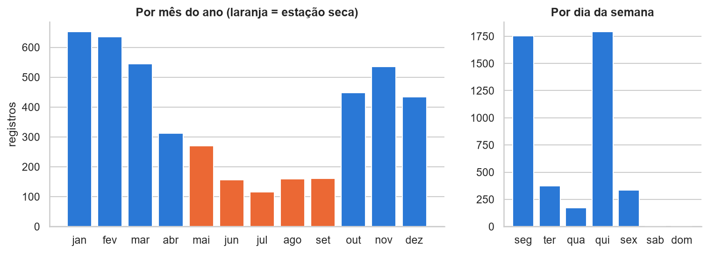
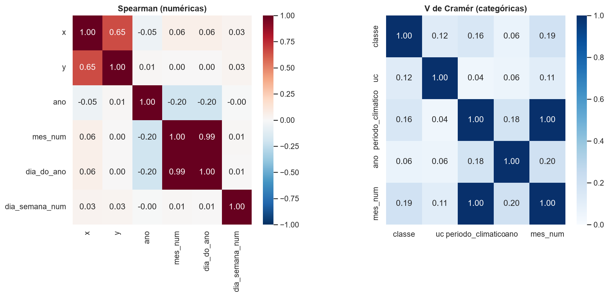

# Etapa 1 - Análise Exploratória do Dataset (RodoFauna / IBRAM-DF)

## 1. Descrição do problema

Base do Projeto RodoFauna (IBRAM/DF): animais encontrados atropelados em percursos sistemáticos nas rodovias do DF entre abr/2010 e mar/2015. Cada linha é uma ocorrência (um animal), com data, classificação taxonômica, unidade de conservação (uc) e coordenadas UTM (x, y).

Objetivo: prever o tipo (classe) e a intensidade/ocorrência de atropelamentos de fauna SILVESTRE e identificar trechos críticos (hotspots).

## 2. Registros, atributos e tipos

Arquivo: data\rodofauna.xlsx  
Base bruta: 10328 registros x 20 atributos  

Tipos dos atributos:  

|  | tipo | valores_distintos | pode_ser_preditor |
|---|---|---|---|
| objectid | int64 | 10328 | não |
| id | int64 | 5164 | não |
| campanha | int64 | 482 | não |
| ano | int64 | 6 | sim |
| periodo | int64 | 5 | não |
| mes | string | 12 | não |
| data_dt | string | 483 | sim |
| dia_da_sem | string | 6 | sim |
| silvestre_ | string | 2 | não |
| classe | string | 5 | alvo |
| ordem | string | 34 | não |
| familia | string | 72 | não |
| especie_nm | string | 192 | alvo |
| nome_popul | string | 176 | não |
| uc | string | 4 | sim |
| x | int64 | 4556 | sim |
| y | int64 | 3858 | sim |
| posicao | string | 11 | não |
| hora | string | 476 | não |
| sexo | string | 4 | não |

silvestre_ (base bruta):  

| silvestre_ | registros |
|---|---|
| silvestre | 8844 |
| domestico | 1484 |

Após filtrar silvestre_ == 'silvestre': 8844 registros  
Registros duplicados (todas as colunas iguais, exceto objectid): 4422  
Valores distintos de 'id' na base bruta: 5164 (em 10328 linhas)  
-> Duplicatas removidas. Base analisada daqui em diante: 4422 registros  
Datas que não puderam ser convertidas: 0  

## 3. Valores ausentes e 'nao_identificado'

|  | ausentes | nao_identificado | %_sem_info |
|---|---|---|---|
| sexo | 0 | 4253 | 96.18 |
| posicao | 0 | 2328 | 52.65 |
| hora | 0 | 1663 | 37.61 |
| especie_nm | 0 | 1001 | 22.64 |
| familia | 0 | 842 | 19.04 |
| ordem | 0 | 171 | 3.87 |
| nome_popul | 0 | 78 | 1.76 |
| uc | 0 | 2 | 0.05 |
| classe | 0 | 1 | 0.02 |

*Figura 1 - Percentual de valores ausentes/nao_identificado por atributo*

## 4. Estatísticas descritivas e outliers

|  | n | média | desvio | mín | 25% | mediana | 75% | máx |
|---|---|---|---|---|---|---|---|---|
| x | 4422 | 199824.18 | 18856.58 | 168694 | 183471.25 | 197849 | 217625.25 | 228478 |
| y | 4422 | 8261912.75 | 17371.29 | 8230610 | 8241139 | 8271545.5 | 8274590.75 | 8282622 |
| ano | 4422 | 2012.29 | 1.39 | 2010 | 2011 | 2012 | 2013 | 2015 |
| mes_num | 4422 | 5.92 | 4.01 | 1 | 2 | 5 | 10 | 12 |
| dia_do_ano | 4422 | 164.9 | 122.44 | 2 | 52 | 125 | 297 | 364 |

Outliers em x e y (critério de Tukey: fora de [Q1 - 1,5*IQR, Q3 + 1,5*IQR]):  
- x: 0 outliers
- y: 0 outliers
- Pontos fora dos limites do DF: 0

*Figura 2 - Boxplots das coordenadas x e y*

## 5. Variáveis-alvo e distribuição das classes

### 5.1 Classificação multiclasse -> alvo: 'classe'

| classe | registros | % |
|---|---|---|
| birds | 3009 | 68.05 |
| reptiles | 690 | 15.6 |
| mammals | 448 | 10.13 |
| amphibians | 274 | 6.2 |
| nao_identificado | 1 | 0.02 |

Razão maior/menor classe: 11.0 : 1  
Acurácia de quem sempre chuta 'birds': 68.1%  

*Figura 3 - Distribuição da variável-alvo classe*

### 5.2 Alvo alternativo 'especie_nm' (classes com poucos exemplos)

Espécies distintas: 179 | registros sem espécie identificada: 1001  
- espécies com >=  10 registros: 59
- espécies com >=  30 registros: 22
- espécies com >= 100 registros: 4
- espécies com < 10 registros: 120 (67% das espécies)

*Figura 4 - 15 espécies mais atropeladas*

### 5.3 e 5.4 Alvos binário e de regressão (células de 500 m)

Classificação binária -> alvo: hotspot (1/0) por célula de 500 m  
Regressão -> alvo: nº de atropelamentos por célula de 500 m por mês  
Células de 500 m com pelo menos 1 atropelamento: 293  
Atropelamentos por célula: média = 15.1, mediana = 10.0, máximo = 96.0  
Painel célula x mês: 293 células x 60 meses = 17580 observações, 83% delas com zero atropelamentos  
Obs.: a base só tem ocorrências; a classe 0 (sem/baixo risco) do problema binário  
- precisa ser construída na Etapa 2 e justificada.

*Figura 5 - Atropelamentos por célula de 500 m*

## 6. Distribuição espacial

Registros por unidade de conservação (uc):  

| uc | registros |
|---|---|
| esecae | 2024 |
| pnb | 1257 |
| jbb_fal_ibge | 1139 |
| nao_identificado | 2 |

10 células mais críticas:  

| célula (x_y) | registros |
|---|---|
| 437_16547 | 96 |
| 438_16547 | 94 |
| 439_16547 | 68 |
| 427_16548 | 62 |
| 441_16548 | 60 |
| 380_16464 | 59 |
| 435_16547 | 58 |
| 440_16548 | 56 |
| 436_16547 | 55 |
| 425_16548 | 52 |

-> concentram 14.9% dos atropelamentos em 3.4% das células  

*Figura 6 - Distribuição espacial por classe*

*Figura 7 - Densidade espacial dos atropelamentos*

## 7. Distribuição temporal

Período: 05/04/2010 a 30/03/2015  
(2010 começa em abril e 2015 termina em março: anos incompletos)  

Registros por ano:  

| ano | registros |
|---|---|
| 2010 | 345 |
| 2011 | 1215 |
| 2012 | 945 |
| 2013 | 928 |
| 2014 | 690 |
| 2015 | 299 |

Registros por mês do ano:  

| mês | registros |
|---|---|
| jan | 652 |
| fev | 635 |
| mar | 545 |
| abr | 312 |
| mai | 270 |
| jun | 156 |
| jul | 115 |
| ago | 159 |
| set | 161 |
| out | 448 |
| nov | 535 |
| dez | 434 |

Registros por dia da semana:  

| dia | registros |
|---|---|
| seg | 1754 |
| ter | 372 |
| qua | 172 |
| qui | 1791 |
| sex | 333 |
| sab | 0 |
| dom | 0 |

Período climático (seco = mai-set, chuvoso = out-abr):  
- chuvoso: 3561 (509 por mês)
- seco:    861 (172 por mês)

*Figura 8 - Série mensal de atropelamentos*

*Figura 9 - Atropelamentos por mês do ano e dia da semana*

## 8. Atributos redundantes e correlação

Concordância dos campos originais com data_dt:  
- ano        x data_dt: 100.0%
- dia_da_sem x data_dt: 99.2%  (35 divergências)
- valores de dia_da_sem: {'qui': 1773, 'seg': 1763, 'ter': 372, 'sex': 333, 'qua': 172, 'eg_': 9}
-> ano, mes e dia_da_sem são deriváveis de data_dt (redundantes).  
Espécies associadas a mais de uma classe: 0 -> especie_nm/ordem/familia determinam a classe (não podem ser entrada).  
Células de 500 m com uma única uc: 93.5% -> uc é quase redundante com (x, y).  

Correlação de Spearman (numéricas):  

|  | x | y | ano | mes_num | dia_do_ano | dia_semana_num |
|---|---|---|---|---|---|---|
| x | 1 | 0.65 | -0.05 | 0.06 | 0.06 | 0.03 |
| y | 0.65 | 1 | 0.01 | 0 | 0 | 0.03 |
| ano | -0.05 | 0.01 | 1 | -0.2 | -0.2 | 0 |
| mes_num | 0.06 | 0 | -0.2 | 1 | 0.99 | 0.01 |
| dia_do_ano | 0.06 | 0 | -0.2 | 0.99 | 1 | 0.01 |
| dia_semana_num | 0.03 | 0.03 | 0 | 0.01 | 0.01 | 1 |

V de Cramér (categóricas):  

|  | classe | uc | periodo_climatico | ano | mes_num |
|---|---|---|---|---|---|
| classe | 1 | 0.12 | 0.16 | 0.06 | 0.19 |
| uc | 0.12 | 1 | 0.04 | 0.06 | 0.11 |
| periodo_climatico | 0.16 | 0.04 | 1 | 0.18 | 1 |
| ano | 0.06 | 0.06 | 0.18 | 1 | 0.2 |
| mes_num | 0.19 | 0.11 | 1 | 0.2 | 1 |

*Figura 10 - Correlação (Spearman) e associação (V de Cramér)*

## 9. Resumo dos problemas encontrados

1. 4422 registros silvestres duplicados (50.0%). Sem removê-los, todas as contagens ficam infladas.  
2. 'sexo' sem informação em 96% dos registros (já excluído como preditor pelo enunciado).  
3. 'posicao' sem informação em 53% dos registros (já excluído como preditor pelo enunciado).  
4. 'hora' sem informação em 38% dos registros (já excluído como preditor pelo enunciado).  
5. 'classe' desbalanceada (11.0:1): 'birds' tem 68% dos registros. Acurácia sozinha é enganosa.  
6. 1 registro(s) com classe = nao_identificado (remover do multiclasse).  
7. Espécies: 120 das 179 têm menos de 10 registros -> classificar por espécie não é viável sem agrupar; por isso o multiclasse usa 'classe'.  
8. Alvo de regressão célula x mês tem 83% de zeros (muitos zeros; avaliar agregação maior, ex.: trimestre).  
9. Nenhum registro em sábado/domingo: as coletas só ocorreram em dias úteis, então 'dia_da_sem' reflete a agenda de coleta, não o risco.  
10. 'dia_da_sem' diverge da data em 35 registros (erro de digitação) - derivar o dia da semana de data_dt.  
11. Pares fortemente associados (>= 0,7): mes_num x dia_do_ano (0.99); periodo_climatico x mes_num (1.00) -> manter só um de cada par.  